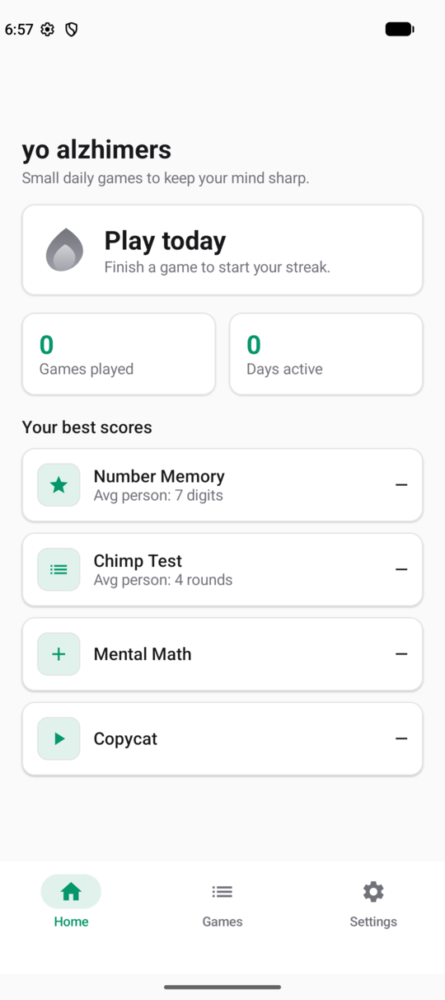
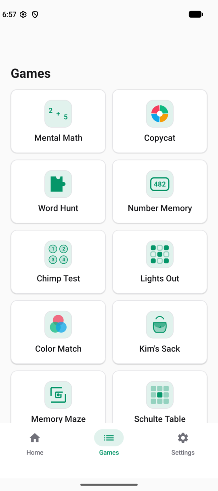
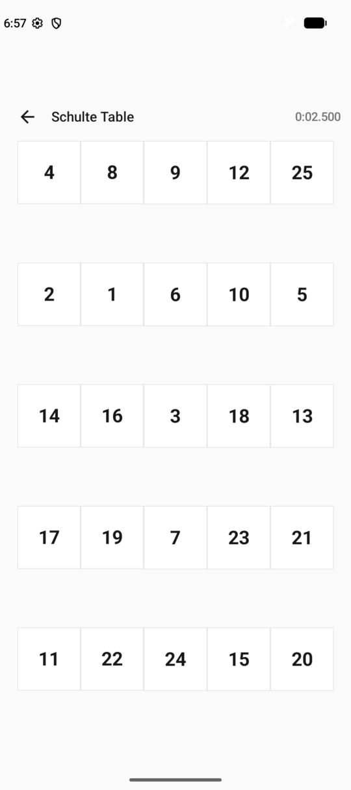
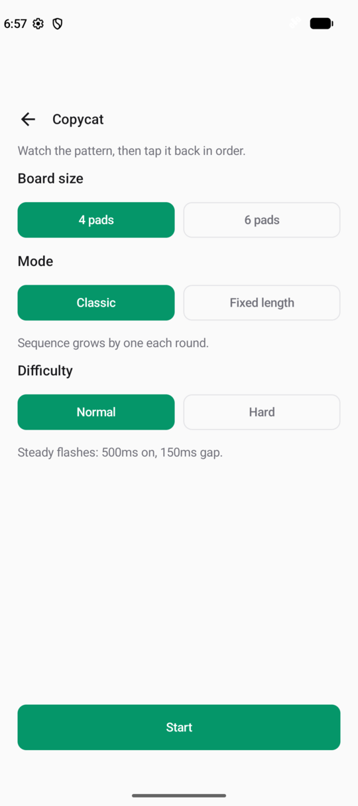
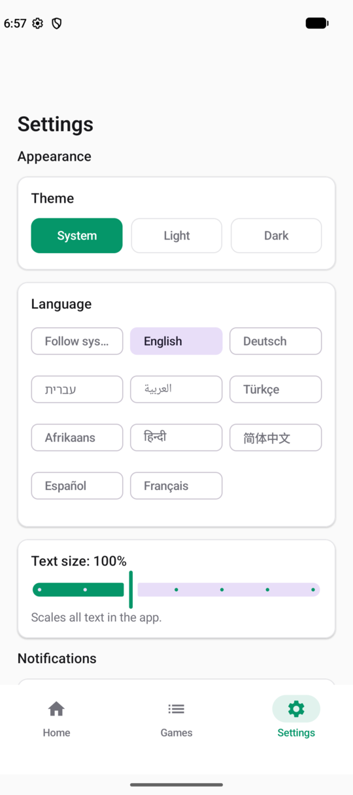

# yo alzhimers

Small daily brain games for Android to keep your mind sharp. Play a game a day to build a streak.

<p>
  
  
  
  
  
</p>

## Games

- **Mental Math**: chains of quick arithmetic
- **Copycat**: watch a pattern of pads, then repeat it
- **Word Hunt**: find the hidden words in a letter grid
- **Number Memory**: memorize a number that grows by one digit each round
- **Chimp Test**: tap numbers in order; after the first tap they hide
- **Lights Out**: toggle candles and their neighbors until all are out
- **Color Match**: match a target color with RGB sliders
- **Kim's Sack**: memorize items on the table, then drag back only the originals
- **Memory Maze**: short-term memory with distraction tasks
- **Schulte Table**: find the numbers in order as fast as you can
- **Percentages**: work out X% of Y against the clock

## Features

- Daily streak, games played, and best scores
- Light, dark, or system theme
- 10 languages: English, Deutsch, Español, Français, Türkçe, Afrikaans, עברית, العربية, हिन्दी, 简体中文
- Adjustable text size
- Daily reminder notifications

## Build

Requires Android 7.0 (API 24) or newer.

```sh
./gradlew :app:assembleDebug
```

Or open the project in Android Studio and run the `app` configuration.
